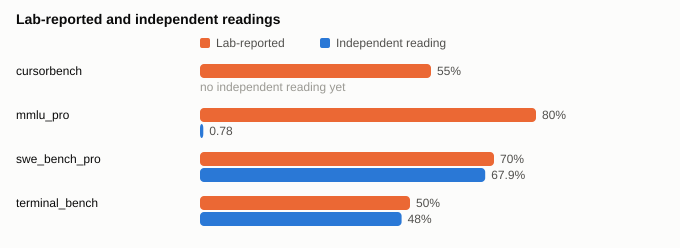
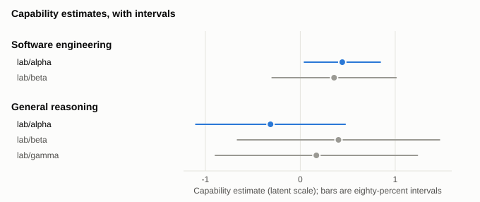

# Alpha 2.5 is in the leading band for software engineering; independent readings sit beside the lab's figures

*Draft release breakdown of Alpha 2.5 (`lab/alpha`), revision `1`. Every number comes from signed snapshot `snap_ee376ecc9678d46b` and links to its fact. Not published: a draft never renders on the site until Jamie approves it.*

## Claims and evidence

Lab-reported figures are quoted from the lab's own page. Independent readings are shown beside them, and a difference is given only for a like-for-like setup.

| Benchmark | Lab-reported | Independent reading | Measured by | Setup | Comparison |
|---|---|---|---|---|---|
| `cursorbench` | 55%[^1] | none yet | — | `version 1.0` | No independent reading yet. |
| `mmlu_pro` | 80%[^2] | 0.78[^3] | an independent evaluator | `version 1.0` | The two use a different unit, so ModelSpec does not compare them. |
| `swe_bench_pro` | 70%[^4] | 67.9%[^6] | an independent evaluator | `version 1.0` | The independent reading is 2.1[^5] points lower than the lab's figure. |
| `terminal_bench` | 50%[^7] | 48%[^8] | an independent evaluator | `version 1.0; effort medium` | The setups differ in effort, so ModelSpec shows both numbers and computes no difference. |

### Not in the announcement

| Benchmark | Independent reading | Measured by | Setup |
|---|---|---|---|
| `livecodebench` | 72%[^9] | an independent evaluator | `version 1.0` |

## Where it lands

Each estimate comes from ModelSpec's capability model, fitted from every admitted benchmark reading, never from one benchmark. Intervals are eighty-percent intervals. P(best) is the share of draws from the fitted model in which a model scores highest in that domain: a statement about the evidence, not a forecast. Estimates are on the capability model's own scale, not a benchmark's percentage: a number means something only beside the estimates of other models, so each domain gives the spread across models of the same class.

**Software engineering.** In software engineering, the model is in the leading band with 1[^10] other model; the evidence does not separate them. Its estimate is 0.44[^11] (interval 0.04[^11] to 0.84[^11]), with P(best) 56.6%[^12] and top-three stability 100.0%[^13]. Across the 3[^14] text generator models with an estimate here, estimates run from -1.06[^15] to 0.44[^16], with a median of 0.36[^17]. It rests on `livecodebench`, `swe_bench_pro`, `swe_bench_pro`, `terminal_bench`, `terminal_bench` (decision `dec_f5d989be9a1a83858623ea9d`).

| Leading-band model | Estimate | P(best) |
|---|---|---|
| `lab/alpha` (this model) | 0.44[^11] (interval 0.04[^11] to 0.84[^11]) | 56.6%[^12] |
| `lab/beta` | 0.36[^18] (interval -0.30[^18] to 1.01[^18]) | 42.6%[^19] |

**General reasoning.** In general reasoning, the model is outside the leading band, at place 3[^20] of 3[^21] ranked models. Its estimate is -0.31[^22] (interval -1.10[^22] to 0.47[^22]), with P(best) 9.4%[^23] and top-three stability 100.0%[^24]. Across the 3[^14] text generator models with an estimate here, estimates run from -0.31[^25] to 0.40[^26], with a median of 0.17[^27]. It rests on `mmlu_pro`, `mmlu_pro` (decision `dec_3ba4671e4a9abe7c8e568239`).

| Leading-band model | Estimate | P(best) |
|---|---|---|
| `lab/beta` | 0.40[^28] (interval -0.66[^28] to 1.47[^28]) | 55.1%[^29] |
| `lab/gamma` | 0.17[^30] (interval -0.89[^30] to 1.23[^30]) | 35.5%[^31] |

### Decision templates it changes

Each row is a decision template whose answer differs between the two snapshots. Other catalogue changes between the snapshots can also move these answers.

| Template | Tier | Model's band before | Model's band after | Left the leading band |
|---|---|---|---|---|
| Coding, best available (`coding-best`) | best | not ranked | leading band | none |

## Cost and access

### Cost per task

At a task of 40,000[^32] input tokens and 4,000[^32] output tokens:

| Offering | Input price | Output price | Cost per task |
|---|---|---|---|
| `sambanova/lab/alpha/global/standard` | $2.00[^33] per million tokens | $8.00[^34] per million tokens | $0.112[^35] |

### Plans

Plans whose own pages cover this model. The break-even is how many tasks a month make the plan cheaper than paying per use, for a coding tool; it is blank when the plan reaches the model directly rather than through a pay-per-use offering.

| Plan | Monthly price | Break-even (tasks a month) | Coverage statement |
|---|---|---|---|
| Pro (`sambanova/subscription/pro`) | $20.00[^36] | — | named directly in the plan's `offering.subscription.models_covered` |

Coverage not yet verified, so these are neither counted as covering nor as not covering: `sambanova/subscription/team`.

Verified not to cover this model: `sambanova/subscription/lite`.

Links to providers and plans go to their own pages. No link carries a referral, affiliate or tracking parameter.

## Hardware fit

The model's weights are not published as open weights in this snapshot, so there is no hardware section.

## Not measured yet

- ModelSpec holds readings of this model that have not yet passed the second key: quarantined: 1[^37]. Their values are not shown.
- Lab figures with no independent reading yet: `cursorbench`.
- Domains with no estimate yet: `engineering_stem`, `maths`, `legal`, `medical`, `finance`, `writing`, `marketing_seo`, `agentic_tool_use`, `vision_documents`, `multilingual`, `chat_preference`.
- Domains this class cannot be measured on, so not a gap: `retrieval`, because retrieval is graded on an embedding or reranking model's ranking, and this class is neither.
- Guaranteed facts still unknown: `feature.batch` (`lab/alpha`), `feature.effort_controls` (`lab/alpha`), `feature.streaming` (`lab/alpha`), `feature.structured_output` (`lab/alpha`), `feature.tool_calling` (`lab/alpha`), `licence.commercial_use` (`lab/alpha`), `licence.fine_tuning` (`lab/alpha`), `licence.output_training` (`lab/alpha`), `model.max_output_tokens` (`lab/alpha`), `model.output_modalities` (`lab/alpha`), `model.release_date` (`lab/alpha`), `offering.attestation.baa` (`sambanova/lab/alpha/global/standard`), `offering.attestation.soc2` (`sambanova/lab/alpha/global/standard`), `offering.data.retention` (`sambanova/lab/alpha/global/standard`), `offering.data.trains_on_customer_data` (`sambanova/lab/alpha/global/standard`), `offering.data.zero_retention` (`sambanova/lab/alpha/global/standard`), `offering.price.batch_input` (`sambanova/lab/alpha/global/standard`), `offering.price.batch_output` (`sambanova/lab/alpha/global/standard`), `offering.price.cached_input` (`sambanova/lab/alpha/global/standard`), `origin.base_lineage` (`lab/alpha`), `origin.lab_jurisdiction` (`lab/alpha`), `origin.weights_hosting` (`lab/alpha`).
- Speed not yet measured under method `speed-v1` for: `sambanova/lab/alpha/global/standard`.

### Re-check schedule

First published 2026-09-26. ModelSpec looks again on these dates. A re-check that changes anything becomes a new, dated revision that shows what changed; one that changes nothing adds no revision.

| After | Due |
|---|---|
| One day | 2026-09-27 |
| Seven days | 2026-10-03 |
| Thirty days | 2026-10-26 |

## Sources and decisions

- Snapshot: `snap_ee376ecc9678d46b`, as of 2026-09-26, content hash `sha256:ee376ecc9678d46b79ced47ec1875537a25f85dc4ee4328ffbc616dd80719e75`, signed with Ed25519 key `ed25519-test`. File: <https://modelspec.dev/api/decision/snapshots/snap_ee376ecc9678d46b.json.gz>.
- Compared with snapshot `snap_29e3163e10b30cc6`, as of 2026-09-26, the last one without this model. File: <https://modelspec.dev/api/decision/snapshots/snap_29e3163e10b30cc6.json.gz>.
- Accuracy: the `pr` profile passed for `snap_ee376ecc9678d46b`.
- Generator: `release_blog` `1.0.0`. Every number in this post is in `breakdown.json` beside it, with its record or computation.

Every decision this post relies on. Re-running a spec against its snapshot gives the same decision ID.

| Purpose | Decision | Snapshot | Spec hash |
|---|---|---|---|
| `cost.coding_tool_plans` | `dec_ff0bb71ca9e5e9acee13bec5` | `snap_ee376ecc9678d46b` | `sha256:db783b07bccfc8759c044b1d1c3603ec453750bce70a9ce48c4064f87e639a23` |
| `standing.reasoning` | `dec_3ba4671e4a9abe7c8e568239` | `snap_ee376ecc9678d46b` | `sha256:12a4c58afeac25a14dbc0b73f6388cc52c885cbd74a7a250fa459b4a8dd5a2c2` |
| `standing.software_engineering` | `dec_f5d989be9a1a83858623ea9d` | `snap_ee376ecc9678d46b` | `sha256:473d43b83ba52068bdb6919a4105aa81f2d1a872096a10e658742130ee66fe27` |
| `template.assistant-balanced` | `dec_8ac72493d8bcd69f3faf1fbd` | `snap_29e3163e10b30cc6` | `sha256:f06b4bffc822ef3635adfbe02397c92c17682d4460ef6c8316dc28f617058996` |
| `template.assistant-balanced` | `dec_875841b8656f5f5040c85187` | `snap_ee376ecc9678d46b` | `sha256:f06b4bffc822ef3635adfbe02397c92c17682d4460ef6c8316dc28f617058996` |
| `template.assistant-best` | `dec_1986b733697ad6e7b1894924` | `snap_29e3163e10b30cc6` | `sha256:e5d377327b2d8a88701871bcc4c2bfb198d9386598cbe617babbf25c084aa272` |
| `template.assistant-best` | `dec_699471885090ace531843936` | `snap_ee376ecc9678d46b` | `sha256:e5d377327b2d8a88701871bcc4c2bfb198d9386598cbe617babbf25c084aa272` |
| `template.assistant-budget` | `dec_474546402d28012817204a28` | `snap_29e3163e10b30cc6` | `sha256:ac9ba0a1e10ef29901cc4bbdede39f4088b26c0c9c37e2ffba6a2b3d582a390e` |
| `template.assistant-budget` | `dec_5693409db80414fe491cb623` | `snap_ee376ecc9678d46b` | `sha256:ac9ba0a1e10ef29901cc4bbdede39f4088b26c0c9c37e2ffba6a2b3d582a390e` |
| `template.assistant-fastest` | `dec_f04b71c703fe25cc0460242c` | `snap_29e3163e10b30cc6` | `sha256:badc9e1ae6efc1667886e1706ccb26d83965e58941adf0766b599168486692bd` |
| `template.assistant-fastest` | `dec_f71dc3f782b7867f1165b480` | `snap_ee376ecc9678d46b` | `sha256:badc9e1ae6efc1667886e1706ccb26d83965e58941adf0766b599168486692bd` |
| `template.budget-coding` | `dec_d19e8aac164e06843261fe82` | `snap_29e3163e10b30cc6` | `sha256:b4b3793cc117b585eaae0bdb5d8051a64d092d726c0179547e6399ffdb3aed90` |
| `template.budget-coding` | `dec_1b4222ff1127e65d1a7601cc` | `snap_ee376ecc9678d46b` | `sha256:b4b3793cc117b585eaae0bdb5d8051a64d092d726c0179547e6399ffdb3aed90` |
| `template.coding-balanced` | `dec_3bd050e4d88770e3e7e0da4a` | `snap_29e3163e10b30cc6` | `sha256:f7d984234e8d668601daccdfb5ac5660dc8bc6087880f66fddb4f18755781b02` |
| `template.coding-balanced` | `dec_5218829cf08d28f54e9e86ba` | `snap_ee376ecc9678d46b` | `sha256:f7d984234e8d668601daccdfb5ac5660dc8bc6087880f66fddb4f18755781b02` |
| `template.coding-best` | `dec_d56bb5fc4d4a6b192042509d` | `snap_29e3163e10b30cc6` | `sha256:576adc4283cc9a1b08d88d618dad590a080ff24c46edc6d4f57325633cb1861c` |
| `template.coding-best` | `dec_cc5ea12badfc6cf99dcf46ea` | `snap_ee376ecc9678d46b` | `sha256:576adc4283cc9a1b08d88d618dad590a080ff24c46edc6d4f57325633cb1861c` |
| `template.coding-fastest` | `dec_8b0806d6677a2095864a53f2` | `snap_29e3163e10b30cc6` | `sha256:8feb4af86c7a337113a87f2aca7c84c346f8ea2a46ffe40c4dd3b59881061c94` |
| `template.coding-fastest` | `dec_95e8dcdf54634d59a7b0c32a` | `snap_ee376ecc9678d46b` | `sha256:8feb4af86c7a337113a87f2aca7c84c346f8ea2a46ffe40c4dd3b59881061c94` |
| `template.coding-private` | `dec_e986f409ce7bf157f9fffa4d` | `snap_29e3163e10b30cc6` | `sha256:019da946a7d7b77212d41220db7e9aeafa414b7cdcd6c857602352ae8acfda58` |
| `template.coding-private` | `dec_bf119ab76692d8af7c910a2a` | `snap_ee376ecc9678d46b` | `sha256:019da946a7d7b77212d41220db7e9aeafa414b7cdcd6c857602352ae8acfda58` |
| `template.documents-best` | `dec_58e48919de7d26c721afe3bf` | `snap_29e3163e10b30cc6` | `sha256:7cab0a9de0e5497ea89bb509fb4ec8010fc52abb4687318e6704894cf10ab32e` |
| `template.documents-best` | `dec_3ff3120016ba60f33ba30c6e` | `snap_ee376ecc9678d46b` | `sha256:7cab0a9de0e5497ea89bb509fb4ec8010fc52abb4687318e6704894cf10ab32e` |
| `template.documents-budget` | `dec_bd334d8e0032af7c5dd48780` | `snap_29e3163e10b30cc6` | `sha256:ec3a6fb8dd9e719941126e92cdf41d761a2994c9f01c440a5395373b60650e68` |
| `template.documents-budget` | `dec_e67dce53f074e583b6174b16` | `snap_ee376ecc9678d46b` | `sha256:ec3a6fb8dd9e719941126e92cdf41d761a2994c9f01c440a5395373b60650e68` |
| `template.documents-fastest` | `dec_5e456e3df394037d82631910` | `snap_29e3163e10b30cc6` | `sha256:8dcc89f0074f9102cc29e88f131cd66f6eb8ef35eff45ea72a59b6a58dc40c89` |
| `template.documents-fastest` | `dec_3b38f84c3c3f1433c6e48ce7` | `snap_ee376ecc9678d46b` | `sha256:8dcc89f0074f9102cc29e88f131cd66f6eb8ef35eff45ea72a59b6a58dc40c89` |
| `template.documents-private` | `dec_59b9058ad102ea4f889c0ded` | `snap_29e3163e10b30cc6` | `sha256:6e167e119bc55a433fc0ad9de5d920f15cd6e3966ef5551a0ba5c332b47ea86b` |
| `template.documents-private` | `dec_77afdd30a48b553a97d599c9` | `snap_ee376ecc9678d46b` | `sha256:6e167e119bc55a433fc0ad9de5d920f15cd6e3966ef5551a0ba5c332b47ea86b` |
| `template.eu-data` | `dec_b2137c1fdab89f377e9e4fd2` | `snap_29e3163e10b30cc6` | `sha256:80d4c1e0e9d2a449eb9efc324304544381cd3c4d3d05ba1e057d144bf66469c5` |
| `template.eu-data` | `dec_c74f206c48b90630b71ae43d` | `snap_ee376ecc9678d46b` | `sha256:80d4c1e0e9d2a449eb9efc324304544381cd3c4d3d05ba1e057d144bf66469c5` |
| `template.high-volume` | `dec_b24f3b34f120b9eae5f9db42` | `snap_29e3163e10b30cc6` | `sha256:1c57b10c04d69cc2d1ec5eafae280a599a6c7a4f73fef633b3234f5a90528565` |
| `template.high-volume` | `dec_880050116765f4023fdeaae9` | `snap_ee376ecc9678d46b` | `sha256:1c57b10c04d69cc2d1ec5eafae280a599a6c7a4f73fef633b3234f5a90528565` |
| `template.high-volume-balanced` | `dec_67fe77de9cce5bede1f245d6` | `snap_29e3163e10b30cc6` | `sha256:d63731f5c34ab1fc7d9db35b8b3ee257cb3588f7d0a97fccf77b4e38e3cb5abb` |
| `template.high-volume-balanced` | `dec_04956ddc13b87b1528519a3b` | `snap_ee376ecc9678d46b` | `sha256:d63731f5c34ab1fc7d9db35b8b3ee257cb3588f7d0a97fccf77b4e38e3cb5abb` |
| `template.high-volume-best` | `dec_396fc3c894faebc7cc186990` | `snap_29e3163e10b30cc6` | `sha256:fab3fef302e83808f2e91ecf2f77d567e2779c4b69257674c90b341a7212a36d` |
| `template.high-volume-best` | `dec_a24460a6e55079da6eb03eaa` | `snap_ee376ecc9678d46b` | `sha256:fab3fef302e83808f2e91ecf2f77d567e2779c4b69257674c90b341a7212a36d` |
| `template.high-volume-fastest` | `dec_03e9a2f8d5356dcd18060c3f` | `snap_29e3163e10b30cc6` | `sha256:c38c9e11262216f4c8d98929400db3ae0359568662289c7b9ec37ed1477eb2d0` |
| `template.high-volume-fastest` | `dec_9b11f7658c1a22f5dbb42810` | `snap_ee376ecc9678d46b` | `sha256:c38c9e11262216f4c8d98929400db3ae0359568662289c7b9ec37ed1477eb2d0` |
| `template.long-documents` | `dec_12ae90ede52b2885d8aba652` | `snap_29e3163e10b30cc6` | `sha256:cb8a0ab7f3ae8b2c0ba7d9a754e02ad27d1b924ef43c04c6652c0cafd47201bf` |
| `template.long-documents` | `dec_ec418e4a823fdd2ef953fe0c` | `snap_ee376ecc9678d46b` | `sha256:cb8a0ab7f3ae8b2c0ba7d9a754e02ad27d1b924ef43c04c6652c0cafd47201bf` |
| `template.maths` | `dec_af782df4b9fb5b00d7cdde2e` | `snap_29e3163e10b30cc6` | `sha256:b214d4974b6b6f1e4839c2ce3e9239b54fe66735d014c0116b8757ad44b20c31` |
| `template.maths` | `dec_2085674465c5087482b0eca9` | `snap_ee376ecc9678d46b` | `sha256:b214d4974b6b6f1e4839c2ce3e9239b54fe66735d014c0116b8757ad44b20c31` |
| `template.maths-reasoning-balanced` | `dec_ee2897b058abe65e94898d4d` | `snap_29e3163e10b30cc6` | `sha256:190a6fb1acf4731fc0db6e30bab7112c2fdceba16d116ecda4e5f9fcde4a894f` |
| `template.maths-reasoning-balanced` | `dec_e1e8d9fa82dde0fd2b6d19ee` | `snap_ee376ecc9678d46b` | `sha256:190a6fb1acf4731fc0db6e30bab7112c2fdceba16d116ecda4e5f9fcde4a894f` |
| `template.maths-reasoning-budget` | `dec_57b2b32540f292aa553f5981` | `snap_29e3163e10b30cc6` | `sha256:3aa1e29976d505b0396e6b4cf1c1f0407c9ea358f6572c9f1eb92e2f1d80a303` |
| `template.maths-reasoning-budget` | `dec_63c67a03464e7ef7041d3fad` | `snap_ee376ecc9678d46b` | `sha256:3aa1e29976d505b0396e6b4cf1c1f0407c9ea358f6572c9f1eb92e2f1d80a303` |
| `template.maths-reasoning-fastest` | `dec_7f1615406dca49447b8d1089` | `snap_29e3163e10b30cc6` | `sha256:24cd7b42981c597d630f2ff36753581254f80737ea471fcc01fe50111dffbb69` |
| `template.maths-reasoning-fastest` | `dec_6970254aa8da5bcf873d7570` | `snap_ee376ecc9678d46b` | `sha256:24cd7b42981c597d630f2ff36753581254f80737ea471fcc01fe50111dffbb69` |
| `template.maths-reasoning-private` | `dec_311e1864cfcd17cac9a12681` | `snap_29e3163e10b30cc6` | `sha256:44f58054ec5503606a9042270171edb98acf1af7c3471e72a1c613579c6860b9` |
| `template.maths-reasoning-private` | `dec_eecb6864231bd317bbc14d9a` | `snap_ee376ecc9678d46b` | `sha256:44f58054ec5503606a9042270171edb98acf1af7c3471e72a1c613579c6860b9` |
| `template.private-self-host` | `dec_61fb9534be38b396a39b7697` | `snap_29e3163e10b30cc6` | `sha256:9b0ac3d8c3f672c6c4b7ebddb958da7688defb0262a9e831b9e81cc02747c5a9` |
| `template.private-self-host` | `dec_510133d71bb4df8ea182afcf` | `snap_ee376ecc9678d46b` | `sha256:9b0ac3d8c3f672c6c4b7ebddb958da7688defb0262a9e831b9e81cc02747c5a9` |
| `template.regional-best` | `dec_971e8a5a6a35aae215ba53cf` | `snap_29e3163e10b30cc6` | `sha256:e3351797db8919ca1f56ca2643a530a4f260ea772a7e652c29fc4c3659e8b90d` |
| `template.regional-best` | `dec_d27ee0b1a10cf2be88fcbaab` | `snap_ee376ecc9678d46b` | `sha256:e3351797db8919ca1f56ca2643a530a4f260ea772a7e652c29fc4c3659e8b90d` |
| `template.regional-budget` | `dec_b0b30171bf59ff914ed313d7` | `snap_29e3163e10b30cc6` | `sha256:9ccbf30c973b30f254b8f85cbee9aa8ad929ce0c91ede7653e8121f633286d2a` |
| `template.regional-budget` | `dec_19e2c86921a3a06c7d67e039` | `snap_ee376ecc9678d46b` | `sha256:9ccbf30c973b30f254b8f85cbee9aa8ad929ce0c91ede7653e8121f633286d2a` |
| `template.regulated-best` | `dec_10bc17b6c7467890beec6982` | `snap_29e3163e10b30cc6` | `sha256:57fc185599ed9f55772eb72166aaa4af7e2465bcf63f4a9a53cbf92e137a7594` |
| `template.regulated-best` | `dec_e7e4595b5d1d7f186bda8155` | `snap_ee376ecc9678d46b` | `sha256:57fc185599ed9f55772eb72166aaa4af7e2465bcf63f4a9a53cbf92e137a7594` |
| `template.regulated-budget` | `dec_3ce6dfe17abecf9e58b638af` | `snap_29e3163e10b30cc6` | `sha256:4697aeac250d5e0e055f855fd6231bdee3348efcc2fa47744185c507654ab9d7` |
| `template.regulated-budget` | `dec_4d304769ef65e50f0eae82c1` | `snap_ee376ecc9678d46b` | `sha256:4697aeac250d5e0e055f855fd6231bdee3348efcc2fa47744185c507654ab9d7` |
| `template.regulated-data` | `dec_fcea396bb679f897b7919d97` | `snap_29e3163e10b30cc6` | `sha256:fa007f4fb3519c61437b3925c6e7fe7b13fc0688b6b4601b3894a4b9fac35319` |
| `template.regulated-data` | `dec_0de3a65551d271de6d32e506` | `snap_ee376ecc9678d46b` | `sha256:fa007f4fb3519c61437b3925c6e7fe7b13fc0688b6b4601b3894a4b9fac35319` |
| `template.retrieval-balanced` | `dec_bc7281a56d435c9782e6b6a5` | `snap_29e3163e10b30cc6` | `sha256:e58abc40d87faffd139da6863dd68fbb8858e12698873c3667a7b877455b7f13` |
| `template.retrieval-balanced` | `dec_61f5b73978bef6d8791d7e1f` | `snap_ee376ecc9678d46b` | `sha256:e58abc40d87faffd139da6863dd68fbb8858e12698873c3667a7b877455b7f13` |
| `template.retrieval-budget` | `dec_660ebe15d35ccdf54be74cb5` | `snap_29e3163e10b30cc6` | `sha256:f5e458629f58c7274a65dc55fe86fa80fd29c69c445291270e0dff94a6e96500` |
| `template.retrieval-budget` | `dec_6324429b4301b2e1ee2f0de9` | `snap_ee376ecc9678d46b` | `sha256:f5e458629f58c7274a65dc55fe86fa80fd29c69c445291270e0dff94a6e96500` |
| `template.retrieval-embeddings` | `dec_13fb695094547646067a1d94` | `snap_29e3163e10b30cc6` | `sha256:28a418e78cac9139b3f5f652fff8a7569314c85c65bb142ca3440211e0b022f3` |
| `template.retrieval-embeddings` | `dec_ca353a0d50efa66b26f52918` | `snap_ee376ecc9678d46b` | `sha256:28a418e78cac9139b3f5f652fff8a7569314c85c65bb142ca3440211e0b022f3` |
| `template.retrieval-fastest` | `dec_6c4a4432c27f67e1a9478350` | `snap_29e3163e10b30cc6` | `sha256:c978f626bc2178eca274c04b329b4aa24775d89a25e32ba86393de43c416975b` |
| `template.retrieval-fastest` | `dec_bd2fca7efc7eb30604cde290` | `snap_ee376ecc9678d46b` | `sha256:c978f626bc2178eca274c04b329b4aa24775d89a25e32ba86393de43c416975b` |
| `template.retrieval-private` | `dec_266784b5107b70ec41b87db1` | `snap_29e3163e10b30cc6` | `sha256:1e151d40a7ee166c1685136289a08407d17efb4841bfbbc3e1d6aff4d6043820` |
| `template.retrieval-private` | `dec_bf32f3ce600f9135eefe57df` | `snap_ee376ecc9678d46b` | `sha256:1e151d40a7ee166c1685136289a08407d17efb4841bfbbc3e1d6aff4d6043820` |
| `template.writing-balanced` | `dec_758fb926500c52b8bb118a26` | `snap_29e3163e10b30cc6` | `sha256:52a9fd13e02e2ed0cff5f4b29ec4adac3c56ed7ab9b7e5cf86984ab547ec4d57` |
| `template.writing-balanced` | `dec_30d958d443054fe70d415be2` | `snap_ee376ecc9678d46b` | `sha256:52a9fd13e02e2ed0cff5f4b29ec4adac3c56ed7ab9b7e5cf86984ab547ec4d57` |
| `template.writing-best` | `dec_5c55a3dd99f1b08c1f887091` | `snap_29e3163e10b30cc6` | `sha256:f009d2952b43e9e426de6c59f9c337631fd5610cb17346b7b2953041b177b262` |
| `template.writing-best` | `dec_a3c4b482e0b2424ec95a0120` | `snap_ee376ecc9678d46b` | `sha256:f009d2952b43e9e426de6c59f9c337631fd5610cb17346b7b2953041b177b262` |
| `template.writing-budget` | `dec_8a4fd8188b8a69a6f73db5d3` | `snap_29e3163e10b30cc6` | `sha256:5a43a915ca88b25467f9d62fe4024bea1e6c388f4fb02013b42b6358ae5c0389` |
| `template.writing-budget` | `dec_358b5b429e8c53eb581925b2` | `snap_ee376ecc9678d46b` | `sha256:5a43a915ca88b25467f9d62fe4024bea1e6c388f4fb02013b42b6358ae5c0389` |
| `template.writing-fastest` | `dec_e760148b52307de187113d18` | `snap_29e3163e10b30cc6` | `sha256:c986d409952e834905dbb892286ce6f88927ee26ea8bd5c0e0c6bcbdb95db12a` |
| `template.writing-fastest` | `dec_acb8598827457753fcf9b487` | `snap_ee376ecc9678d46b` | `sha256:c986d409952e834905dbb892286ce6f88927ee26ea8bd5c0e0c6bcbdb95db12a` |
| `template.writing-private` | `dec_6b9788c6a1aa36b6dc27b84c` | `snap_29e3163e10b30cc6` | `sha256:16ce68c8cb92440a5e644cd9eccde032cfb78ecb5c6d3060a78cab578a07f3d4` |
| `template.writing-private` | `dec_77926f6cbc9cf4e7c100afac` | `snap_ee376ecc9678d46b` | `sha256:16ce68c8cb92440a5e644cd9eccde032cfb78ecb5c6d3060a78cab578a07f3d4` |

Sources cited:

- `src-board`: <https://board.example.org/results>
- `src-lab-page`: <https://lab.example.com/alpha-launch>
- `src-pricing`: <https://lab.example.com/pricing>

No referral fees, no paid placement, no provider-paid visibility, permanently. See <https://modelspec.dev/legal/neutrality/>. This post follows the release breakdown standard: <https://modelspec.dev/blog/standard/>.

[^1]: Fact `lab/alpha#cursorbench#55.0` in snapshot `snap_ee376ecc9678d46b`, verified 2026-09-20. Source: <https://lab.example.com/alpha-launch>.
[^2]: Fact `lab/alpha#mmlu_pro#80.0` in snapshot `snap_ee376ecc9678d46b`, verified 2026-09-20. Source: <https://lab.example.com/alpha-launch>.
[^3]: Fact `lab/alpha#mmlu_pro#0.78` in snapshot `snap_ee376ecc9678d46b`, verified 2026-09-20. Source: <https://board.example.org/results>.
[^4]: Fact `lab/alpha#swe_bench_pro#70.0` in snapshot `snap_ee376ecc9678d46b`, verified 2026-09-20. Source: <https://lab.example.com/alpha-launch>.
[^5]: Computed: the independent reading minus the lab's figure (`difference`), from snapshot `snap_ee376ecc9678d46b`. Records: `lab/alpha#swe_bench_pro#67.9`, `lab/alpha#swe_bench_pro#70.0`.
[^6]: Fact `lab/alpha#swe_bench_pro#67.9` in snapshot `snap_ee376ecc9678d46b`, verified 2026-09-20. Source: <https://board.example.org/results>.
[^7]: Fact `lab/alpha#terminal_bench#50.0` in snapshot `snap_ee376ecc9678d46b`, verified 2026-09-20. Source: <https://lab.example.com/alpha-launch>.
[^8]: Fact `lab/alpha#terminal_bench#48.0` in snapshot `snap_ee376ecc9678d46b`, verified 2026-09-20. Source: <https://board.example.org/results>.
[^9]: Fact `lab/alpha#livecodebench#72.0` in snapshot `snap_ee376ecc9678d46b`, verified 2026-09-20. Source: <https://board.example.org/results>.
[^10]: Computed: the number of models in the decision's best band (`decision.bands.best`), from snapshot `snap_ee376ecc9678d46b`. Decision `dec_f5d989be9a1a83858623ea9d`.
[^11]: Computed: the capability model's estimate, fitted from every admitted benchmark reading (`capability.estimate`), from snapshot `snap_ee376ecc9678d46b`. Records: `lab/alpha#livecodebench#72.0`, `lab/alpha#swe_bench_pro#67.9`, `lab/alpha#swe_bench_pro#70.0`, `lab/alpha#terminal_bench#48.0`, `lab/alpha#terminal_bench#50.0`.
[^12]: Computed: P(best) from the decision (`decision.p_best`), from snapshot `snap_ee376ecc9678d46b`. Decision `dec_f5d989be9a1a83858623ea9d`.
[^13]: Computed: top-three stability from the decision (`decision.top3_stability`), from snapshot `snap_ee376ecc9678d46b`. Decision `dec_f5d989be9a1a83858623ea9d`.
[^14]: Computed: capability.spread (`capability.spread`), from snapshot `snap_ee376ecc9678d46b`.
[^15]: Computed: capability.spread (`capability.spread`), from snapshot `snap_ee376ecc9678d46b`.
[^16]: Computed: capability.spread (`capability.spread`), from snapshot `snap_ee376ecc9678d46b`.
[^17]: Computed: capability.spread (`capability.spread`), from snapshot `snap_ee376ecc9678d46b`.
[^18]: Computed: the capability model's estimate, fitted from every admitted benchmark reading (`capability.estimate`), from snapshot `snap_ee376ecc9678d46b`. Records: `lab/beta#livecodebench#65.0`, `lab/beta#swe_bench_pro#60.0`, `lab/beta#terminal_bench#55.0`.
[^19]: Computed: P(best) from the decision (`decision.p_best`), from snapshot `snap_ee376ecc9678d46b`. Decision `dec_f5d989be9a1a83858623ea9d`.
[^20]: Computed: the model's place among the decision's ranked models (`decision.model_rank`), from snapshot `snap_ee376ecc9678d46b`. Decision `dec_3ba4671e4a9abe7c8e568239`.
[^21]: Computed: the number of models the decision ranked (`decision.ranked_models`), from snapshot `snap_ee376ecc9678d46b`. Decision `dec_3ba4671e4a9abe7c8e568239`.
[^22]: Computed: the capability model's estimate, fitted from every admitted benchmark reading (`capability.estimate`), from snapshot `snap_ee376ecc9678d46b`. Records: `lab/alpha#mmlu_pro#0.78`, `lab/alpha#mmlu_pro#80.0`.
[^23]: Computed: P(best) from the decision (`decision.p_best`), from snapshot `snap_ee376ecc9678d46b`. Decision `dec_3ba4671e4a9abe7c8e568239`.
[^24]: Computed: top-three stability from the decision (`decision.top3_stability`), from snapshot `snap_ee376ecc9678d46b`. Decision `dec_3ba4671e4a9abe7c8e568239`.
[^25]: Computed: capability.spread (`capability.spread`), from snapshot `snap_ee376ecc9678d46b`.
[^26]: Computed: capability.spread (`capability.spread`), from snapshot `snap_ee376ecc9678d46b`.
[^27]: Computed: capability.spread (`capability.spread`), from snapshot `snap_ee376ecc9678d46b`.
[^28]: Computed: the capability model's estimate, fitted from every admitted benchmark reading (`capability.estimate`), from snapshot `snap_ee376ecc9678d46b`. Records: `lab/beta#mmlu_pro#70.0`.
[^29]: Computed: P(best) from the decision (`decision.p_best`), from snapshot `snap_ee376ecc9678d46b`. Decision `dec_3ba4671e4a9abe7c8e568239`.
[^30]: Computed: the capability model's estimate, fitted from every admitted benchmark reading (`capability.estimate`), from snapshot `snap_ee376ecc9678d46b`. Records: `lab/gamma#mmlu_pro#60.0`.
[^31]: Computed: P(best) from the decision (`decision.p_best`), from snapshot `snap_ee376ecc9678d46b`. Decision `dec_3ba4671e4a9abe7c8e568239`.
[^32]: Task size: the decision contract's default task (`DEFAULT_TASK_TOKENS`).
[^33]: Fact `sambanova/lab/alpha/global/standard#offering.price.input` in snapshot `snap_ee376ecc9678d46b`, verified 2026-09-20. Source: <https://lab.example.com/pricing>.
[^34]: Fact `sambanova/lab/alpha/global/standard#offering.price.output` in snapshot `snap_ee376ecc9678d46b`, verified 2026-09-20. Source: <https://lab.example.com/pricing>.
[^35]: Computed: list price for one task: (input price × input tokens + output price × output tokens) ÷ 1,000,000 (`offering.cost_per_task`), from snapshot `snap_ee376ecc9678d46b`. Records: `sambanova/lab/alpha/global/standard#offering.price.input`, `sambanova/lab/alpha/global/standard#offering.price.output`. Sources: <https://lab.example.com/pricing>.
[^36]: Fact `sambanova/subscription/pro#offering.subscription.price` in snapshot `snap_ee376ecc9678d46b`, verified 2026-09-20. Source: <https://lab.example.com/pricing>.
[^37]: Computed: the count of this model's records the snapshot held back, by reason (`content.held_back`) (`snapshot.held_back`), from snapshot `snap_ee376ecc9678d46b`.
